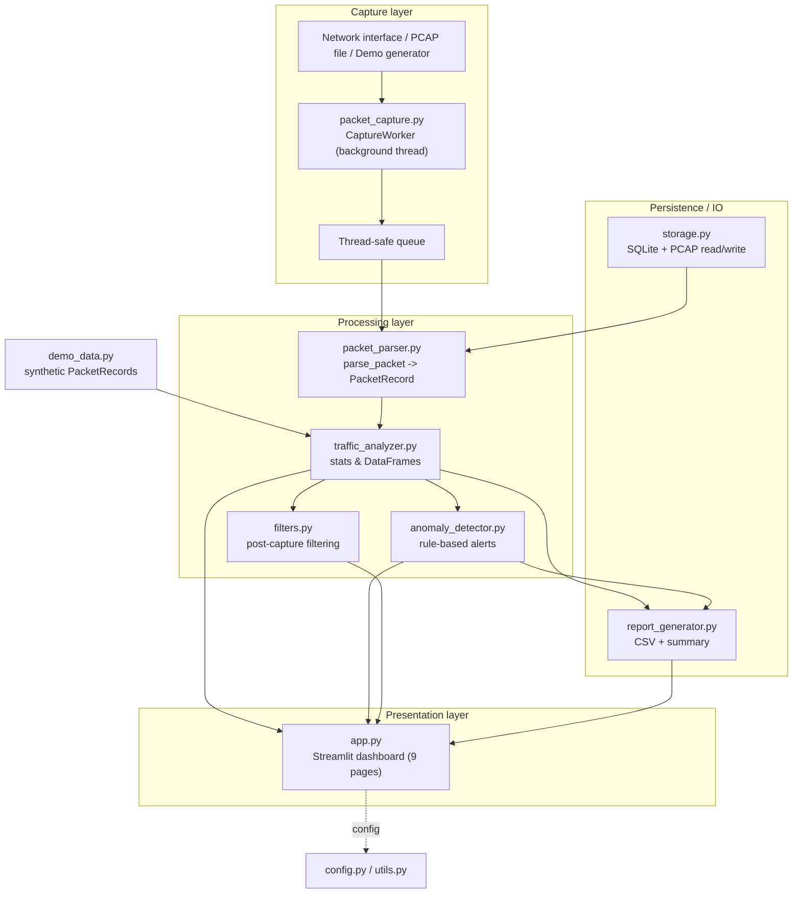
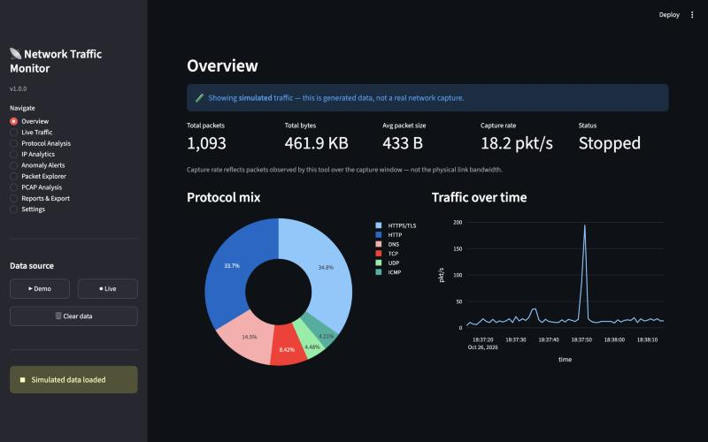
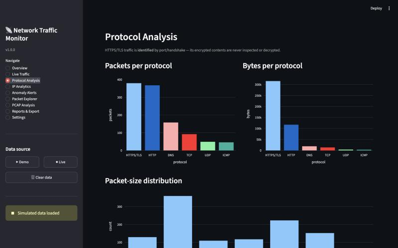
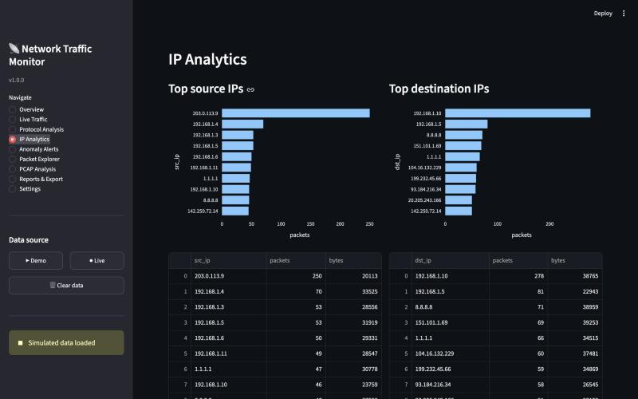
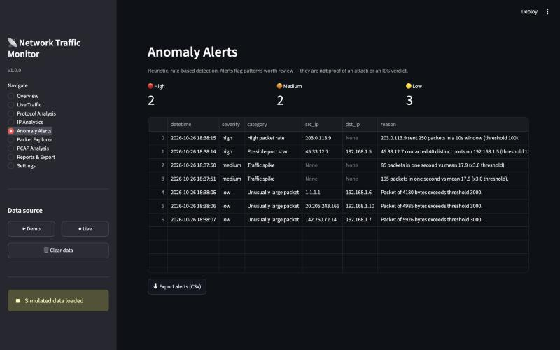
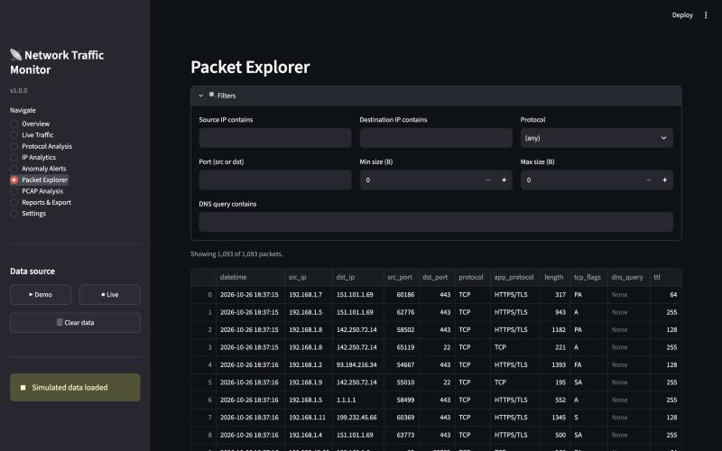
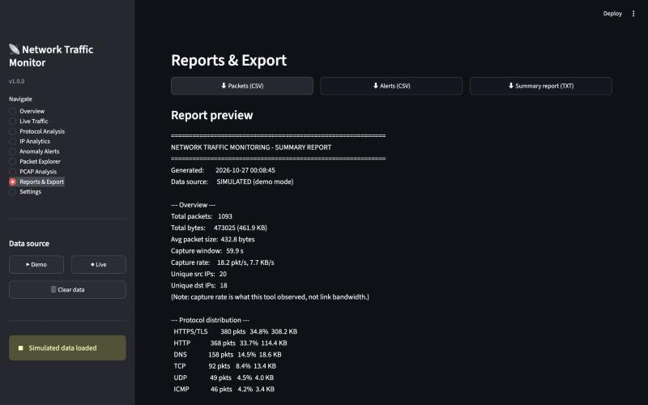
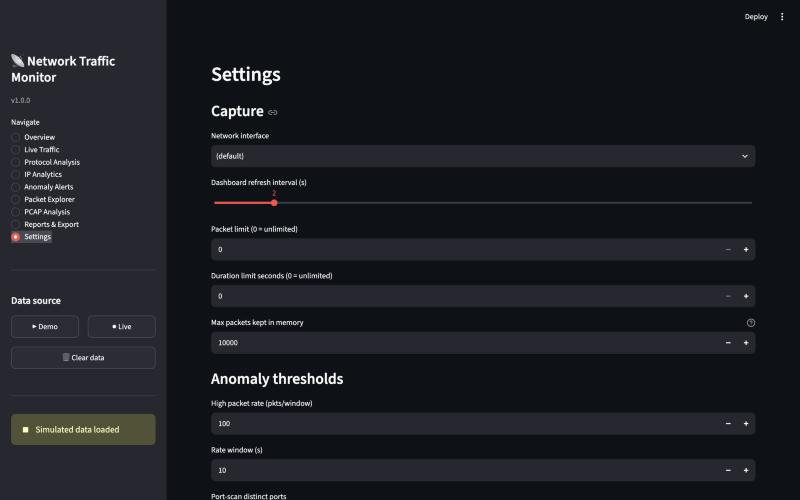

# Network Traffic Monitoring and Analysis Tool

**BCSE308P Computer Networks Lab — Innovative Evaluation Practices (Fall 2026-27)**
**Slot:** F2 · **Team:** 32 · **Member:** Sanchit Kumar (23BCE0043)

### Submission files

| File / folder | Contents |
|---------------|----------|
| [`F2_Team32_Report.pdf`](F2_Team32_Report.pdf) | Project report (VTOP Assignment 8) — editable source: `F2_Team32_Report.docx` |
| [`F2_Team32_PPT.pptx`](F2_Team32_PPT.pptx) | Project presentation (VTOP Assignment 9) |
| `*.py`, `requirements.txt`, `pytest.ini` | Complete source code and configuration |
| [`tests/`](tests) | Pytest unit-test suite |
| [`test_results/`](test_results) | Test run output, demo summary report and generated alerts |
| [`screenshots/`](screenshots) | Dashboard screenshots (also zipped as `F2_Team32_Screenshots.zip`) |
| `F2_Team32_SourceCode.zip` | Snapshot archive of the source code |

> No Cisco Packet Tracer (`.pkt`) file is included: this is a software
> (Python dashboard) project, not a simulated-topology project.

A Python application that captures, analyzes, and visualizes network traffic
through an interactive Streamlit dashboard. It demonstrates core computer
networking concepts — the TCP/IP stack, protocol identification, addressing,
TCP connection behavior, and traffic analysis — with a fully working **demo
mode** that needs no special privileges or internet connection.

> **Educational tool.** Monitor only networks and devices you own or have
> explicit permission to monitor. See [Security & Ethics](#security--ethics).

---

## Table of Contents
1. [Problem Statement & Objectives](#problem-statement--objectives)
2. [Features](#features)
3. [Architecture](#architecture)
4. [Technology Stack](#technology-stack)
5. [Module Descriptions](#module-descriptions)
6. [Installation](#installation)
7. [Running the App](#running-the-app)
8. [Demo Mode](#demo-mode)
9. [Live Packet Capture & OS Permissions](#live-packet-capture--os-permissions)
10. [Testing](#testing)
11. [Screenshots](#screenshots)
12. [Computer Networks Concepts Demonstrated](#computer-networks-concepts-demonstrated)
13. [Security & Ethics](#security--ethics)
14. [Limitations](#limitations)
15. [Future Enhancements](#future-enhancements)
16. [Viva Questions & Answers](#viva-questions--answers)
17. [Demonstration Scripts](#demonstration-scripts)
18. [Why This Is a Meaningful CN Project](#why-this-is-a-meaningful-cn-project)

---

## Problem Statement & Objectives

**Problem.** Network administrators and students need to understand *what* is
flowing across a network link — which protocols dominate, which hosts talk to
which, how much data moves, and whether any pattern looks abnormal. Raw packet
dumps (e.g. `tcpdump`) are hard to read and reason about.

**Objectives.**
- Capture packets from a selected interface (where privileges allow) or analyze
  saved captures / simulated data.
- Extract and normalize header metadata from each packet.
- Classify traffic by protocol and summarize it statistically.
- Identify top talkers, busy ports, and active conversations.
- Flag suspicious patterns with transparent, configurable rules.
- Present everything in a clean, interactive dashboard.
- Remain fully demonstrable offline with no admin rights.

---

## Features

| Area | What it does |
|------|--------------|
| **Live monitoring** | Start/stop capture on a chosen interface, with packet-count/duration limits and live counters. Graceful handling of permission/interface errors. |
| **Packet inspection** | Per-packet timestamp, src/dst IP, src/dst port, transport protocol, size, TCP flags, app-protocol guess, DNS query name, ICMP type/code, TTL. |
| **Protocol analysis** | Packets & bytes per protocol, percentage mix, packet-size distribution. |
| **IP analytics** | Top source/destination IPs, busiest ports, top src→dst conversations. |
| **Traffic over time** | Packets/sec and bytes/sec time series. |
| **Anomaly detection** | Rule-based alerts: high packet rate, port scans, large packets, traffic spikes, repeated TCP resets — with severity and reasons. |
| **Filtering** | Filter captured data by IP, protocol, port, size range, time range, DNS name — without restarting capture. |
| **Export & reporting** | CSV of packets and alerts, a text summary report, PCAP save, PCAP upload for offline analysis. |
| **Demo mode** | Realistic synthetic traffic (normal + suspicious) requiring no privileges. |

---

## Architecture



**Data flow.** Packets enter from one of three sources (live NIC, PCAP file, or
the demo generator). The capture worker parses each packet into a flat
`PacketRecord` and pushes it onto a bounded thread-safe queue. The Streamlit
app drains the queue on each rerun, accumulates records (capped to bound
memory), converts them to a pandas DataFrame, and feeds the analyzer, anomaly
detector, filters, and report generator that drive the dashboard.

---

## Technology Stack

| Technology | Role | Why |
|-----------|------|-----|
| **Python 3.11+** | Core language | Modern typing, broad library support. |
| **Scapy** | Packet capture & parsing | Pure-Python, layer-aware packet model; builds packets for tests without a live network. |
| **Streamlit** | Dashboard | Rapid, pure-Python interactive web UI; no JS needed. |
| **pandas** | Data processing | Fast grouping/aggregation over packet tables. |
| **Plotly** | Charts | Interactive, zoomable charts embedded in Streamlit. |
| **SQLite** | Optional storage | Zero-config embedded DB for packet metadata. |
| **pytest** | Testing | Simple fixtures; synthetic packets keep tests privilege-free. |

---

## Module Descriptions

| File | Responsibility |
|------|----------------|
| `app.py` | Streamlit dashboard, session-state lifecycle, 9 pages, capture-thread control across reruns. |
| `config.py` | Paths, constants, well-known ports, `AnomalyThresholds`, `Settings` dataclasses. |
| `utils.py` | Byte/rate formatting, filename sanitization, safe path confinement. |
| `packet_parser.py` | `PacketRecord` schema, `parse_packet()`, TCP-flag decoding, protocol classification. |
| `traffic_analyzer.py` | DataFrame building, summary stats, protocol distribution, top talkers/ports/conversations, time series, size histogram. |
| `anomaly_detector.py` | Five rule-based detectors + aggregation and severity ordering. |
| `filters.py` | `PacketFilter` + `apply_filter()` over captured DataFrames. |
| `demo_data.py` | Synthetic traffic generator (normal + injected anomalies). |
| `packet_capture.py` | `CaptureWorker` threaded Scapy sniffer, interface listing, Scapy availability checks. |
| `storage.py` | SQLite `PacketStore`, PCAP `save_pcap`/`load_pcap`. |
| `report_generator.py` | CSV exports and text summary report. |
| `tests/` | Pytest suite using synthetic packet fixtures. |

---

## Installation

Requires **Python 3.11 or newer**. Check with `python3 --version`.

### 1. Get the project
```bash
git clone https://github.com/Sanchitkumar18/computer-networks.git
cd computer-networks
```

### 2. Create and activate a virtual environment

**macOS / Linux**
```bash
python3 -m venv venv
source venv/bin/activate
```

**Windows (PowerShell)**
```powershell
py -3.11 -m venv venv
venv\Scripts\Activate.ps1
```

### 3. Install dependencies
```bash
pip install --upgrade pip
pip install -r requirements.txt
```

> **Windows live capture only:** install **Npcap** (https://npcap.com) with
> "WinPcap API-compatible mode". Not needed for demo mode or PCAP analysis.
>
> **Linux live capture:** `sudo apt-get install libpcap-dev` (Debian/Ubuntu).
> macOS ships with libpcap.

---

## Running the App

```bash
streamlit run app.py
```

Streamlit prints a local URL (default http://localhost:8501). Open it in a
browser. Use the **sidebar** to pick a data source (Demo / Live) and navigate
the nine pages.

---

## Demo Mode

Demo mode needs **no privileges and no network**.

1. Launch the app: `streamlit run app.py`
2. In the sidebar, click **▶ Demo**.
3. ~1,100 simulated packets load (normal traffic plus an injected port scan,
   a packet flood, and oversized packets).
4. Explore every page. The **Anomaly Alerts** page will show high-packet-rate,
   port-scan, traffic-spike, and large-packet alerts.

The sidebar clearly marks the data as **simulated**; it is generated, not
captured from a real network.

---

## Live Packet Capture & OS Permissions

Live capture reads raw frames from a NIC, which **requires elevated privileges
on every operating system**. Demo mode and PCAP analysis do not.

| OS | How to enable live capture |
|----|----------------------------|
| **macOS** | Run from a terminal with `sudo`: `sudo $(which streamlit) run app.py`. macOS uses the BPF devices (`/dev/bpf*`); sudo grants access. Alternatively `sudo chmod` the BPF devices (advanced). |
| **Linux** | Run with `sudo streamlit run app.py`, **or** grant capabilities once: `sudo setcap cap_net_raw,cap_net_admin=eip $(readlink -f $(which python))`. |
| **Windows** | Install **Npcap**, then run the terminal / PowerShell **as Administrator** before `streamlit run app.py`. |

If capture is attempted without privileges the app shows a clear error and
suggests Demo Mode rather than crashing.

**Troubleshooting**
- *"Permission denied"* → you are not running elevated; use sudo/Administrator.
- *No interfaces listed* → Scapy/libpcap not available or no privileges.
- *Nothing captured* → the chosen interface may be idle; generate traffic
  (e.g. open a web page) or pick the active interface in **Settings**.
- *Scapy not detected* → `pip install -r requirements.txt` inside the venv.

---

## Testing

```bash
source venv/bin/activate      # Windows: venv\Scripts\Activate.ps1
pytest
```

Tests use **synthetic Scapy packets** built in memory, so they run without a
live network or admin rights.

**Actual result on this machine (Python 3.11.9, macOS):**
```
37 passed in 0.84s
```

The full verbose run is saved in
[`test_results/F2_Team32_TestResults.txt`](test_results/F2_Team32_TestResults.txt).
The same folder holds a demo-mode summary report and the alerts CSV it
produced (1,093 packets → 8 alerts: 1 high packet rate, 1 port scan,
3 traffic spikes, 3 large packets — matching the injected anomalies).

Coverage includes: TCP/UDP/ICMP/DNS/ARP/IPv6 parsing, malformed/missing-field
packets, protocol classification, counters and rate math, top-talker/port
aggregation, all five anomaly rules (above and below threshold), IP/port/size/
time filtering, empty datasets, CSV export, and demo-data generation.

---

## Screenshots

All screenshots were taken in Demo Mode (simulated traffic).

**Overview** — packet/byte totals, capture rate, protocol mix and traffic over time


**Protocol Analysis** — packets and bytes per protocol, packet-size distribution


**IP Analytics** — top source and destination IPs


**Anomaly Alerts** — injected flood, port scan, traffic spikes and large packets detected


**Packet Explorer** — per-packet table with live filters


**Reports & Export** — CSV / summary-report downloads and report preview


**Settings** — capture options and configurable anomaly thresholds


---

## Computer Networks Concepts Demonstrated

- **OSI / TCP-IP layering.** `packet_parser.py` walks link (Ethernet/ARP),
  network (IPv4/IPv6), transport (TCP/UDP/ICMP), and application (DNS/HTTP(S))
  layers — the same stack packets traverse on the wire.
- **Ethernet / IP / TCP / UDP headers.** The parser reads IP src/dst and TTL,
  TCP/UDP ports, and the TCP flags byte; the UI exposes each field.
- **TCP flags (SYN/ACK/FIN/RST).** `decode_tcp_flags()` turns the flags byte
  into letters. A lone `S` is a connection attempt; `SA` is the handshake
  response; `R` is a reset. The reset detector uses this.
- **TCP vs UDP.** TCP is connection-oriented with flags and handshakes; UDP is
  connectionless (DNS/NTP here). Both are classified and counted separately.
- **DNS analysis.** When a DNS layer is present the query name is extracted and
  shown/filterable.
- **IP ↔ port relationship.** An IP identifies a host; a port identifies a
  service/process on it. Conversations are keyed by IP pairs, services by port.
- **Packets vs bytes vs throughput vs bandwidth.** The app reports packet
  counts, byte totals, and a *capture rate* (what this tool saw), and documents
  that this is **not** the link's physical **bandwidth** (max capacity) or true
  end-to-end **throughput**.
- **Packet filtering.** `filters.py` mirrors how capture filters (BPF) narrow
  traffic, but applied post-capture over a DataFrame.
- **Anomaly vs intrusion detection.** See below.
- **Encrypted-traffic limits.** HTTPS/TLS is *identified* by port 443 / the TLS
  handshake; its payload is **never decrypted**. We see metadata, not content.
- **Interface visibility.** A host NIC generally sees its own traffic plus
  broadcast/multicast; on a switched LAN it does not see other hosts' unicast
  traffic unless a SPAN/mirror port or monitor mode is used.

---

## Security & Ethics

- Capture **only** on networks/devices you own or are explicitly authorized to
  monitor. Unauthorized interception may be illegal.
- This project does **not** implement credential harvesting, password
  extraction, session hijacking, packet injection, or offensive scanning.
- It does **not** attempt to decrypt TLS.
- By default only **header metadata** is stored — not payloads. SQLite storage
  is optional, and in-memory retention is capped (`MAX_PACKETS_IN_MEMORY`).
- Exported filenames are sanitized and paths are confined to `captures/`
  (`utils.safe_output_path`) to prevent path traversal.

---

## Limitations

- **Privileges:** live capture needs root/Administrator; demo & PCAP modes do
  not.
- **Switched networks:** a normal NIC sees only its own + broadcast traffic.
- **Encryption:** TLS payloads cannot be inspected — only metadata.
- **Direction:** "incoming vs outgoing" is inferred from private vs public IP
  heuristics and is not always reliable (NAT, VPNs, multi-homing).
- **Capture rate ≠ bandwidth:** the tool may drop packets under heavy load; its
  rate reflects observed packets, not link capacity.
- **Anomaly rules are heuristic:** thresholds can produce false positives /
  negatives; they are prompts for human review, not verdicts.
- **Single host:** no distributed/remote capture.

---

## Future Enhancements

- GeoIP / reverse-DNS enrichment of IP addresses.
- Deeper application-protocol parsing (HTTP methods, TLS SNI hostnames).
- Statistical/ML-based anomaly detection alongside the rules.
- Live BPF capture filters configurable from the UI.
- Persistent historical dashboards backed by SQLite.
- Alerting integrations (email/Slack) and scheduled reports.

---

## Viva Questions & Answers

**1. What does this project do?**
It captures or simulates network packets, extracts header metadata, classifies
traffic by protocol, computes statistics (top talkers, rates, distributions),
flags suspicious patterns with rules, and shows it all in a Streamlit
dashboard.

**2. Why does live capture need admin privileges?**
Reading raw frames bypasses the OS's normal socket abstraction and touches the
NIC directly (BPF on macOS/Linux, Npcap driver on Windows). The OS restricts
that to privileged users for security.

**3. How does packet capture actually work?**
The NIC (often in promiscuous mode) passes frames to the kernel's capture
facility (libpcap/Npcap). Scapy's `sniff()` receives copies of those frames and
calls our callback per packet, which we parse and enqueue.

**4. What is promiscuous mode?**
A NIC mode where it accepts all frames it sees, not just those addressed to its
MAC. Needed to observe traffic not destined for the host.

**5. Why can't you see other hosts' traffic on a switch?**
A switch forwards unicast frames only out the port toward the destination MAC.
Without a mirror/SPAN port you only see your own unicast plus broadcast/
multicast.

**6. Explain the TCP three-way handshake and how you detect it.**
SYN → SYN-ACK → ACK. We decode the TCP flags byte: a packet with only `S` is a
SYN; `SA` is SYN-ACK. Many SYNs to many ports from one source suggests a scan.

**7. What are TCP flags SYN/ACK/FIN/RST?**
SYN starts a connection, ACK acknowledges data, FIN closes gracefully, RST
aborts/refuses. We expose them per packet and count RSTs per source.

**8. TCP vs UDP?**
TCP: connection-oriented, reliable, ordered, flow/congestion control, uses
flags/handshake (HTTP, HTTPS, SSH). UDP: connectionless, best-effort, low
overhead (DNS, NTP, video). Both are parsed and classified here.

**9. Difference between a packet, a byte, throughput, and bandwidth?**
A packet is one unit of data with headers; bytes are its size. Throughput is
actual data moved per second; bandwidth is the link's maximum capacity. Our
"capture rate" is observed packets/bytes per second — not bandwidth.

**10. How do you classify application protocols? Is it reliable?**
Heuristically, from well-known ports and Scapy layers (443→HTTPS/TLS, 53→DNS,
80→HTTP). It's a reasonable guess, not proof — services can run on non-standard
ports.

**11. Can you see inside HTTPS traffic?**
No. We identify TLS/HTTPS by port and handshake but never decrypt the payload.
We see metadata (who, when, how much), not content.

**12. How is DNS handled?**
When a packet has a DNS layer we extract the query name (`DNSQR.qname`). It's
displayed and filterable; DNS usually rides UDP/53.

**13. What is the difference between IPv4 and IPv6 here?**
Both are parsed; we record `ip_version`. IPv4 uses `ttl`, IPv6 uses the hop
limit field. Addresses differ (32-bit dotted quad vs 128-bit hex).

**14. What is ARP and why show it?**
Address Resolution Protocol maps IP→MAC on a LAN. It's link-layer; we classify
it separately and read the sender/target IPs.

**15. How does ICMP appear?**
As type/code (e.g. type 8 = echo request/ping, type 0 = echo reply). Used by
ping and traceroute.

**16. How does your anomaly detection work?**
Five transparent rules over the captured DataFrame: high packet rate per
source, a port scan (many distinct ports probed on a single destination,
counting only SYN connection-initiation packets so ordinary reply traffic is
not misflagged), oversized packets, per-second traffic spikes vs the mean, and
repeated TCP RSTs. Each has a configurable threshold.

**17. How is anomaly detection different from intrusion detection?**
An IDS uses curated signatures and/or trained models and aims to decide whether
an attack occurred, often with response actions. Our detector only flags
statistically unusual patterns for a human to judge — no verdict, no response.

**18. Why could your alerts be false positives?**
A backup job or a CDN can legitimately produce high rates or large transfers; a
health-checker can hit many ports. Thresholds are heuristic, so human review is
required.

**19. How do you keep memory bounded during long captures?**
Packets are stored with a cap (`MAX_PACKETS_IN_MEMORY`); once exceeded, oldest
records are dropped. The capture queue is bounded and drops oldest on overflow.
Scapy sniffs with `store=False` so it doesn't retain packets.

**20. How do you pass packets from the capture thread to the UI safely?**
A `queue.Queue` (thread-safe). The background `CaptureWorker` enqueues parsed
records; the Streamlit script drains it on each rerun. No shared mutable state
without the queue.

**21. Streamlit reruns the whole script on every click — how do you avoid
starting many capture threads?**
The `CaptureWorker` lives in `st.session_state` and is created once. We check
`worker.running` and guard start/stop, so reruns reuse the single instance.

**22. How do filters work without restarting capture?**
Filtering is applied to the already-captured pandas DataFrame
(`filters.apply_filter`), independent of capture — change filters any time.

**23. How do you handle malformed or truncated packets?**
`parse_packet` is fully defensive: every field access is guarded, unknown
layers fall back to `Other`, and any exception is caught so one bad packet
never crashes the pipeline. A test builds a junk frame to prove this.

**24. What does the PCAP feature do?**
`save_pcap` writes raw Scapy packets to a `.pcap`; `load_pcap` reads a `.pcap`
and parses it into records for offline analysis (upload on the PCAP page). No
privileges needed to read a file.

**25. How is the project tested without a live network?**
pytest builds synthetic Scapy packets in memory (IP/TCP/UDP/ICMP/DNS/ARP) and
asserts on parsed fields, stats, filters, and anomaly rules — 37 tests, all
passing.

**26. How do you determine traffic direction?**
Heuristically from private (RFC 1918) vs public IPs. It's unreliable under NAT/
VPN/multi-homing, which we document as a limitation.

**27. What security/privacy safeguards are built in?**
Header-only storage by default, bounded retention, sanitized export filenames,
path-traversal protection, no TLS decryption, and no offensive capabilities.

**28. Why Scapy, Streamlit, pandas, Plotly?**
Scapy gives a pure-Python, layer-aware packet model (and builds test packets);
Streamlit yields an interactive UI in pure Python; pandas does fast
aggregation; Plotly renders interactive charts.

---

## Demonstration Scripts

### Two-minute explanation
> "This is a Python network traffic monitor. Packets come from one of three
> sources — a live interface, a saved PCAP file, or a built-in simulator — and
> a background thread parses each one into a normalized record with its IP
> addresses, ports, protocol, size, and TCP flags. Those records flow through a
> thread-safe queue into a Streamlit dashboard. pandas aggregates them into
> statistics: protocol mix, top talkers, busiest ports, and traffic over time.
> A rule-based detector flags patterns like port scans, floods, oversized
> packets, and repeated resets, always as prompts for human review rather than
> definitive attack verdicts. Everything runs offline in demo mode with no
> admin rights, and I can export CSVs, a summary report, and PCAP files. It
> directly exercises the TCP/IP stack — link, network, transport, application
> layers — and makes the difference between packets, bytes, capture rate, and
> bandwidth concrete, while being honest that encrypted HTTPS content is never
> inspected."

### Five-minute live demo
1. **Launch** `streamlit run app.py`; show the sidebar and status indicator.
2. **Demo data:** click **▶ Demo**; note the "simulated data" banner.
3. **Overview:** point out total packets/bytes, avg size, capture rate, and the
   protocol pie; explain capture rate ≠ bandwidth.
4. **Protocol Analysis:** show packets/bytes-per-protocol bars and the size
   histogram; explain HTTPS is identified, not decrypted.
5. **IP Analytics:** top source/destination IPs, busiest ports, conversations.
6. **Anomaly Alerts:** show the injected **port scan** and **high packet rate**
   alerts; open **Settings**, lower a threshold, return and show more alerts —
   demonstrating configurability.
7. **Packet Explorer:** filter by protocol = DNS and by an IP; show counts
   update live without restarting.
8. **Reports & Export:** download the summary report and a CSV.
9. **PCAP Analysis:** mention you can upload a real `.pcap` for offline work.
10. **(Optional, if elevated)** stop demo, start **Live**, browse a website,
    watch counters climb; stop cleanly.

---

## Why This Is a Meaningful CN Project

It is not just charts: every number traces back to a real header field parsed
from the packet, across all four TCP/IP layers. It demonstrates genuine
networking understanding — connection behavior via TCP flags, the IP/port
service model, DNS resolution, the packet/byte/throughput/bandwidth
distinction, and the hard limits of monitoring on switched and encrypted
networks — while remaining ethical, privilege-aware, fully testable, and
demonstrable offline. That combination of working software, honest framing of
limitations, and clear mapping to course concepts is what makes it a solid
computer-networks project.
